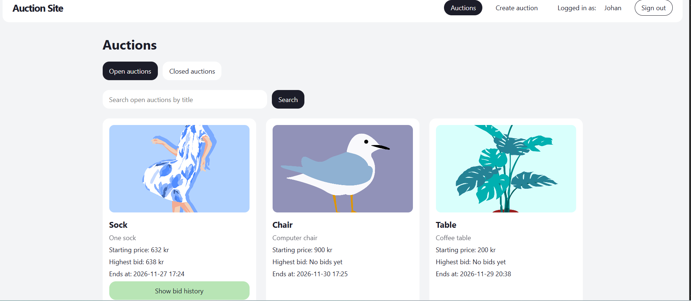
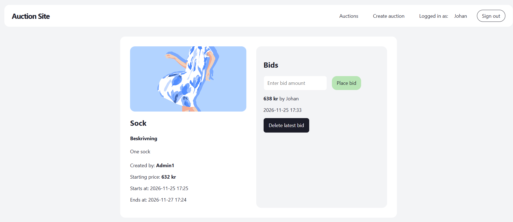
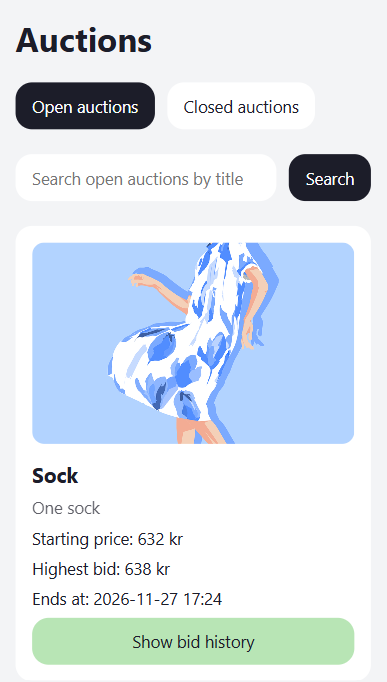

# Auction Site web

### Auction overview

### Delete latest bid 

### Mobile view

A full-stack auction application built with React, TypeScript, ASP.NET Core Web API and SQL Server. Users can browse auctions, create their own auctions and place bids. Administrators can manage the active status of users and auctions.

The project was developed as part of a full-stack development course, with a focus on authentication, authorization, REST API communication, separation of concerns and responsive design.

## Features

### Visitors

- Browse and search open and closed auctions by title.
- View auction details and bid history for open auctions.
- View the winning bid on closed auctions.
- Register an account and sign in.

### Authenticated users

- Create auctions with a title, description, starting price, start date and end date.
- Update their own open auctions. The starting price cannot be changed after a bid has been placed.
- Place bids on other users' open auctions. Each bid must exceed the current highest bid or the starting price if there are no bids.
- Withdraw their own bid if it is the latest bid on an open auction.
- Change their password through My Pages.

### Administrators

- View users and auctions in the admin portal.
- Activate and deactivate user accounts and auctions.
- Deactivated accounts cannot sign in, and deactivated auctions are excluded from public listings and searches.

## Tech stack

| Frontend | Backend |
| --- | --- |
| React 19 | ASP.NET Core Web API (.NET 10) |
| TypeScript | C# |
| Vite | Entity Framework Core 10 |
| React Router | SQL Server |
| Context API | JWT Bearer authentication |
| CSS | ASP.NET Core PasswordHasher |
| React Hot Toast | Swagger / Swashbuckle |

## Project structure

The frontend communicates with the REST API using Fetch. React Router handles navigation and protected routes, while Context API manages authentication state. Shared CSS custom properties keep the visual design consistent across components.

The backend separates HTTP handling (controllers), business logic (services) and database access (repositories). Interfaces and dependency injection connect the layers, while DTOs define the data exchanged through the API. Entity Framework Core handles persistence and database migrations.
